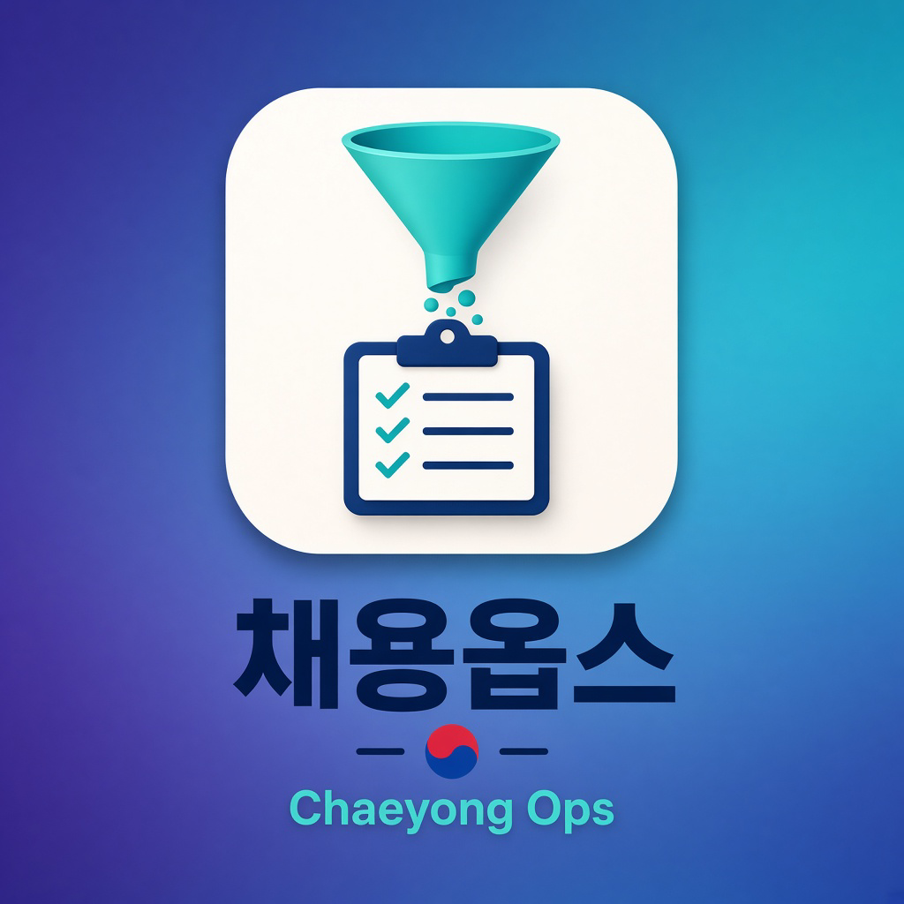
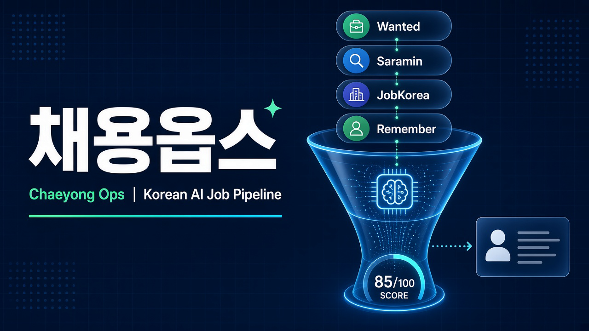

<!-- 문서 유형: 시작 안내. 대상: 국내 채용 공고로 구직하는 개인 사용자.
     목표: 설치와 개인 설정을 마치고 첫 공고 평가와 지원 준비 묶음을 생성한다. -->

<p align="center">
  
</p>

<h1 align="center">채용옵스 · Chaeyong Ops</h1>

<p align="center">
  <strong>공고 찾기부터 맞춤 이력서까지, 한국어로.</strong><br>
  내 경력과 희망 조건을 기준으로 공고를 평가하고, 지원할 곳을 골라 준비하세요.
</p>

<p align="center">
  <a href="#처음-시작하기"></a>
  <a href="https://nodejs.org/"></a>
  <a href="LICENSE"></a>
</p>

<p align="center">
  <a href="#처음-시작하기">시작하기</a> ·
  <a href="#실행-방식-선택하기">사용 방법</a> ·
  <a href="#원하는-공고만-찾기">검색 설정</a> ·
  <a href="#지원-현황-보드-열기">지원 현황</a> ·
  <a href="#문제가-생겼을-때">문제 해결</a>
</p>

<p align="center">
  
</p>

채용옵스는 국내 채용 공고 수집, 내 경력과의 적합도 평가, 맞춤 이력서와 지원 답변 작성을 돕는 오픈소스 도구입니다. **시스템은 지원서를 제출하지 않습니다. 생성된 자료를 직접 검토하고, 실제 지원 제출은 직접 진행합니다.** [career-ops](https://github.com/career-ops-hq/career-ops)를 한국 채용 시장에 맞게 수정한 포크입니다.

## 채용옵스로 할 수 있는 일

내 이력서와 희망 조건을 한 번 설정해 두고, 공고마다 다음 흐름으로 사용합니다.


| 할 일 | 채용옵스가 돕는 부분 |
| --- | --- |
| 공고 찾기 | 원티드·잡코리아·사람인에서 키워드와 지역으로 공고 수집 |
| 내 조건에 맞게 거르기 | 희망 직종·경력 연차·지원하지 않을 회사를 설정에 반영 |
| 지원 여부 판단 | 경력·기술·조건·공고 진위와 지원서 초안을 A–H 구조로 검토하고 원문 보존 |
| 한국 채용 조건 확인 | 정규직, 수습, 포괄임금제, 4대 보험 등 국내 채용 맥락 반영 |
| 지원 자료 만들기 | 실제 경력을 바탕으로 맞춤 이력서·PDF·지원 답변 초안 생성 |
| 진행 상황 관리 | 평가 기록과 PDF를 트래커에 연결하고 웹·터미널 보드에서 확인 |
| 지원 전략 상담 | 취업 컨설팅 스킬로 직종·연차에 맞는 지원 방향 검토 |
| 직접 검토·제출 | 시스템은 절대 지원서를 제출하지 않습니다 — the system never submits an application. 최종 판단과 제출은 사용자가 합니다. <!-- hitl: absolute guarantee. Do not add "automatically", "by itself", "without your permission" or any other hedge when translating this row. --> |

프로젝트의 한국 지원 가이드는 4.0/5 이상 공고를 우선 검토하도록 권장합니다. 점수는 판단을 돕는 참고 자료입니다. 공고의 실제 조건과 생성된 문서의 경력·수치·연락처를 확인한 뒤 사용하세요.

## 처음 시작하기

**5분 시작 안내:** 설치·기본 설정을 먼저 마치고, 이력서와 희망 조건을 본인 정보로 채워 갑니다.

Git, **Node.js 22.5 이상 권장**, npm이 필요합니다. 아래 터미널 명령은 저장소 최상위 폴더에서 실행합니다. 지원 현황 보드에는 Go가 추가로 필요하며, 요구 버전은 [보드 안내](#지원-현황-보드-열기)에서 확인합니다.

### 1. 프로젝트 설치하기

저장소를 내려받고 필요한 패키지를 설치합니다. `npm install`은 브라우저 자동화에 쓰는 Chromium 설치도 실행합니다.

```bash
git clone https://github.com/torisKR/chaeyong-ops.git
cd chaeyong-ops
npm install
```

### 2. 안내에 따라 내 설정 만들기

일반 터미널에서 다음 명령을 실행하면 이름·이메일, 희망 직종, 경력 연차, 지원하지 않을 회사, 도시와 출력 언어를 차례로 묻습니다. macOS·Linux·Windows에서 같은 Node 명령을 사용합니다.

```bash
node setup.mjs
```

설정에 필요한 파일이 없으면 예시에서 복사합니다. 기존 파일의 복사는 건너뛰며, 질문에 답한 항목은 해당 설정 파일에 반영합니다. **Enter로 건너뛴 항목은 예시 값이나 기존 값을 유지하므로, 복사만으로 개인화가 끝나지는 않습니다.**

| 파일 | 확인할 내용 |
| --- | --- |
| `config/profile.yml` | 이름·연락처, 희망 직종, `experience.years`, 희망·최저 연봉, 근무 가능 조건 |
| `portals.yml` | 검색어, 지역, 활성 포털, `blocked_companies`(지원하지 않을 회사) |
| `cv.md` | 본인의 실제 경력·프로젝트·학력·기술 |
| `modes/_profile.md` | 본인에게 맞는 평가 기준과 희망 역할 |

**예시에는 김예시라는 가상 인물의 경력·기술·연봉과 예시 회사명이 들어 있습니다.** `cv.md`와 프로필 전체를 확인하고 본인의 정보로 바꾸거나 해당하지 않는 내용을 삭제하세요. 희망 직종을 골라도 나머지 예시 경력과 평가 기준까지 모두 바뀌지는 않습니다.

직종·연차·제외 회사만 다시 설정하려면 다음 명령을 사용합니다. 프로필이 여전히 예시 상태이면 이름 등 기본 정보도 다시 물을 수 있습니다.

```bash
node setup.mjs --configure
```

<details>
<summary>질문 없이 설정 예시만 복사하고 싶다면</summary>

`npm run setup`은 `node setup.mjs --defaults`를 실행합니다. 질문 없이 누락된 파일만 복사하므로 이후 직접 수정해야 합니다. `node setup.mjs`도 대화형 터미널이 아니면 질문을 건너뜁니다.

```bash
npm run setup
```

</details>

한국어 출력과 국내 채용 기준을 사용하려면 프로필의 다음 설정을 확인합니다. `cv.template`은 한국어 이력서 양식을 선택합니다.

```yaml
language:
  output: ko
  modes_dir: modes/ko

cv:
  template: ko-standard
```

같은 이름의 `language:`나 `cv:` 항목이 이미 있으면 그 안의 값을 수정하세요. 동일한 항목을 파일 끝에 중복 추가하지 않습니다.

### 3. 내 이력서 등록하기

복사된 `cv.md`를 본인의 실제 이력서로 바꿉니다. 아래 항목을 채우거나, AI 도구에 기존 이력서를 전달해 정리를 요청하세요.

```markdown
# 본인 이름

## 소개
희망 직무와 실제 경험을 요약합니다.

## 경력
회사명, 직무, 재직 기간, 담당 업무와 확인 가능한 성과를 적습니다.

## 프로젝트
본인이 기여한 내용과 범위를 구분해 적습니다.

## 학력
학교, 전공, 졸업 여부를 적습니다.

## 기술
실제로 사용한 기술과 활용 경험을 적습니다.
```

경력·성과·프로젝트의 기준 자료는 `cv.md`입니다. 확인하지 못한 수치나 사용 경험이 없는 기술을 추가하지 마세요. `experience.years`도 실제 총 경력으로 고칩니다. 소수 연도이므로 1년 6개월은 `1.5`이며, 출시 프로젝트 수를 경력 연수로 바꾸어 적지 않습니다.

### 4. 설정 확인하고 평가 기준 맞추기

진단 명령으로 직종·연차·제외 회사와 필요한 설정을 확인합니다.

```bash
node doctor.mjs
```

에이전트나 스크립트가 읽을 JSON 결과가 필요하면 `node doctor.mjs --json`을 사용합니다. 이 명령은 누락된 개인화 파일을 템플릿에서 생성하고, 아직 수정하지 않은 항목을 알려줍니다.

`modes/_profile.md`와 `modes/_brief.md`가 템플릿 상태라면 본인의 직무·경력·희망 조건으로 수정하세요. AI 도구를 사용한다면 다음처럼 요청할 수 있습니다.

```text
cv.md와 config/profile.yml을 읽고 내 경력과 희망 조건을 기준으로
modes/_profile.md와 modes/_brief.md를 한국어로 개인화해줘.
파일에 없는 경력이나 성과는 추가하지 마.
```

설치·설정을 더 자세히 보고 싶다면 [한국어 시작 안내](docs/GETTING-STARTED-KR.md)를 참고하세요.

## 실행 방식 선택하기

평소 사용하는 AI 코딩 도구에서 자연어로 요청하거나, OpenRouter API를 연결해 터미널 명령으로 실행할 수 있습니다.

| 방식 | 준비할 것 | 사용 방법 |
| --- | --- | --- |
| AI 코딩 도구 | Codex·Claude Code·Cursor 등 사용하는 도구의 설치와 인증 | 저장소를 열고 한국어로 요청 |
| OpenRouter 터미널 실행 | OpenRouter API 키 | `npm run or:*` 명령 실행 |

스캔은 모델 API를 호출하지 않습니다. 평가와 지원 자료 생성에는 AI가 필요하며, 선택한 도구·제공업체에 CV·프로필·공고 등의 문맥이 전달됩니다. 모델 사용료와 한도는 해당 제공업체에서 확인하세요.

### AI 도구에서 한국어로 요청하기

프로젝트 폴더를 연 뒤 원하는 작업을 요청합니다. Codex에서는 저장소 최상위에서 `codex`를 실행할 수 있습니다.

```text
채용옵스 scan 모드로 새 공고를 찾아줘.

이 공고를 채용옵스로 평가해줘: 복사한_공고_URL

리포트 1번을 기준으로 맞춤 이력서와 PDF, 지원 답변을 준비해줘.

채용옵스 tracker 모드로 지원 현황을 보여줘.
```

스킬 명령을 지원하는 도구에서는 `/chaeyong-ops scan`도 사용할 수 있습니다. 슬래시 명령이 보이지 않으면 위처럼 자연어로 요청하세요.

Codex에서 한 번의 요청만 실행하려면 `codex exec`에 한국어 프롬프트(prompt)를 전달합니다. 저장소 최상위에서 실행하세요.

```bash
codex exec "채용옵스 scan 모드로 새 공고를 찾고 결과를 요약해줘."
```

Codex의 작업 규칙은 [CODEX.md](CODEX.md), 대화형·단발 실행 방법은 [Codex 실행 안내](docs/CODEX.md)에서 확인할 수 있습니다.

직종 선택이나 지원 전략부터 상담하고 싶다면 다음처럼 요청합니다. [취업 컨설팅 스킬](.agents/skills/chaeyong-ops-consulting/SKILL.md)이 직종·연차·제외 회사와 실제 경력을 기준으로 상담합니다.

```text
채용옵스 취업 컨설팅으로 내 경력에 맞는 직종과 지원 전략을 검토해줘.
```

<details>
<summary>추가로 사용할 수 있는 한국어 모드</summary>

필요한 작업의 모드 이름을 함께 요청합니다.

| 모드 | 할 일 |
| --- | --- |
| `gonggo` · `oferta` | 공고 평가 |
| `triage` | 공고 1차 검토 |
| `pipeline` | 대기 중인 공고 평가 |
| `pdf` | 맞춤 이력서 PDF 생성 |
| `jiwon` · `apply` | 지원서 작성 준비 |
| `cover` · `email` | 자기소개서·지원 메일 초안 |
| `deep` | 회사 심층 조사 |
| `ofertas` | 여러 제안 비교 |
| `interview` | 면접 준비 |

</details>

### OpenRouter로 터미널에서 실행하기

[OpenRouter API 키 관리](https://openrouter.ai/settings/keys)에서 키를 발급받은 뒤 `.env.example`을 `.env`로 복사합니다. macOS·Linux·Git Bash에서는 다음 명령을 사용합니다. `-n` 옵션은 기존 파일을 보존합니다.

```bash
cp -n .env.example .env
```

PowerShell에서는 `if (!(Test-Path .env)) { Copy-Item .env.example .env }`를 실행합니다. `.env`를 열고 다음 값에 본인의 키를 입력하세요. 다른 제공업체의 예시 API 키를 모두 채울 필요는 없습니다.

```dotenv
OPENROUTER_API_KEY=your_openrouter_api_key_here
```

공고를 저장하기 전에 검색 결과를 미리 확인합니다.

```bash
npm run or:scan -- --dry-run
```

설정이 맞으면 결과를 저장하고, 대기 공고를 평가합니다. 스캔만 실행하려면 `npm run scan:kr`도 같은 스캐너를 사용합니다.

```bash
npm run or:scan
npm run or:pipeline
```

`or:pipeline`은 `data/pipeline.md`의 **모든 대기 공고를 평가**합니다. PDF와 답변을 만들려면 평가 후 지원할 리포트를 선택해 `or:apply`를 실행합니다.

공고 하나부터 평가하려면 다음 명령을 실행합니다. 안내가 나오면 공고 URL을 붙여넣고 빈 줄에서 Enter를 누릅니다.

```bash
npm run or:eval
```

저장된 리포트 번호가 `001`이라면 다음 명령으로 지원 자료를 만듭니다.

```bash
npm run or:apply -- 1
```

기본 실행은 OpenRouter에서 무료로 표시된 모델을 조회합니다. 가용 모델과 호출 한도에 따라 요청이 실패할 수 있습니다. `.env`에서 `CAREER_OPS_MODEL`을 지정하면 해당 모델을 직접 사용하므로, 지정한 모델의 요금을 확인하세요.

## 원하는 공고만 찾기

검색 대상과 필터는 `portals.yml`에서 수정합니다. 직종·연차·제외 회사를 다시 고를 때는 `node setup.mjs --configure`를 사용합니다. 직종 선택은 희망 역할과 제목 필터, 원티드 검색 설정을 맞추며, 다른 포털의 활성 여부는 직접 관리합니다.

제공되는 한국 포털 설정의 기본 활성 상태는 다음과 같습니다.

| 포털 | 수집 방식 | 예시 설정의 기본값 |
| --- | --- | --- |
| 원티드 | 공개 목록 API | 활성화 |
| 잡코리아 | Node Playwright로 렌더링된 카드 읽기 | 비활성화 |
| 사람인 | Node Playwright로 렌더링된 카드 읽기 | 비활성화 |
| 리멤버 | 공개 HTML 목록을 읽는 초기 구현 | 비활성화 |

잡코리아·사람인·리멤버를 사용하려면 각 사이트의 이용약관과 자동 수집 허용 범위를 확인한 뒤 `enabled: true`로 바꾸세요. MIT 라이선스는 채용 사이트의 이용약관을 대체하지 않습니다. 로그인·보안 차단·연결 실패가 발생하면 확인 불가로 남깁니다. 리멤버는 브라우저를 구동하지 않는 초기 구현으로, 자바스크립트 렌더링이나 보안 차단 때문에 공고를 읽지 못할 수 있습니다.

처음에는 포털별 `max_pages: 1`로 조회량을 줄여 설정을 확인합니다. 다음은 기존 `job_boards` 항목을 수정하는 예시입니다.

```yaml
job_boards:
  - name: Wanted — 백엔드
    provider: wanted
    careers_url: https://www.wanted.co.kr/
    searchKeywords: "백엔드"
    max_pages: 1
    enabled: true
```

포털 검색어와 결과 필터는 별도로 동작합니다.

| 설정 | 용도 |
| --- | --- |
| `searchKeywords` | 지원하는 포털에 전달할 검색어. 리멤버는 공개 목록을 제목 필터로 거름 |
| `title_filter.positive` | 수집된 공고 제목에서 찾을 키워드 |
| `title_filter.negative` | 제외할 제목 키워드 |
| `location_filter` | 근무 지역 필터 |
| `content_filter.negative` | 목록 응답에 본문이 있을 때 제외할 문구 |
| `blocked_companies` | 스캔에서 제외할 회사. `data/blacklist.md`와 함께 적용 |

프로필의 `experience.years`에 따라 고연차·시니어 제목 제외 조건도 추가됩니다. 연차가 없으면 임의의 경력 밴드를 가정하지 않습니다. 상세 공고의 필수 경력과 평가 기준은 [한국 지원 워크플로](docs/APPLY-KR.md)에서 확인하세요.

지원하지 않을 회사가 없으면 `portals.yml`의 예시 회사 목록을 `blocked_companies: []`로 바꿉니다. 특정 포털만 미리 보려면 이름으로 범위를 좁힙니다. 아래 명령은 이름에 `Wanted`가 들어간 설정만 조회합니다.

```bash
npm run or:scan -- --company Wanted --dry-run
```

<details>
<summary>영어 필수 조건을 필터에 추가하기</summary>

`portals.yml`의 기존 `content_filter`를 수정합니다. 한국 포털 예시에는 영어 관련 제외 문구가 들어 있으므로, 영어 사용 직무도 찾는다면 목록을 조정하세요.

```yaml
content_filter:
  negative:
    - "영어 회화 필수"
    - "native english"
```

이 필터는 목록 응답에 채용 본문이 있는 경우에만 적용됩니다. 본문이 없으면 필터를 통과하므로, 영어 필수 여부는 상세 공고 평가에서도 확인하세요.

</details>

## 결과 파일 확인하기

기본 설정에서는 다음 위치에 결과가 쌓입니다. 평가 번호와 생성된 PDF를 트래커에서 함께 확인할 수 있습니다.

| 위치 | 저장 내용 |
| --- | --- |
| `data/pipeline.md` | 수집한 공고와 평가 대기 목록 |
| `reports/` | 공고별 평가와 보존한 공고 원문 |
| `data/applications.md` | 평가·지원 현황과 PDF 링크 |
| `output/리포트명/cv.html` | 맞춤 이력서 HTML |
| `output/리포트명/cv.pdf` | 제출 전 검토할 이력서 PDF |
| `output/리포트명/answers.md` | 지원 답변 초안 |
| `output/리포트명/prepared.json` | 지원 준비가 성공한 묶음의 기록 |

OpenRouter의 `or:apply`는 트래커의 PDF 링크를 갱신합니다. 평가된 공고는 `Evaluated` 상태를 유지하며, 실제 제출 후 지원 상태를 별도로 기록합니다. 생성에 실패하면 이전에 완성된 지원 자료를 보존합니다.

개인 데이터 위치를 바꾸려면 `CAREER_OPS_ROOT` 또는 `CAREER_OPS_DATA_DIR`을 사용합니다. 상세 기준은 [데이터 계약](DATA_CONTRACT.md)에서 확인하세요.

## 지원 현황 보드 열기

**Go 1.25+**가 설치되어 있다면 브라우저에서 지원 기록을 확인할 수 있습니다.

```bash
npm run dashboard:web
```

터미널에 나온 주소 **http://127.0.0.1:3847**을 브라우저로 엽니다. 웹 보드는 이 컴퓨터의 루프백 주소에서 동작하며, 지원 표는 읽기 전용입니다. `/settings`에서는 제외 회사를 편집하고 직종·연차를 확인할 수 있습니다.

| 방식 | 명령 | 할 수 있는 일 |
| --- | --- | --- |
| 웹 보드 | `npm run dashboard:web` | 지원 표 조회·검색·필터, 제외 회사 설정 |
| 터미널 UI | `npm run serve:dashboard` | 지원 표 조회, 리포트 열기, 상태 변경 |

두 보드는 같은 `data/applications.md`를 읽습니다. 웹 보드에서 상태를 바꾸려면 AI 도구의 `tracker` 모드를 사용하거나 터미널 UI에서 수정하세요. 화면의 지원완료는 `Applied`, 평가완료는 `Evaluated`에 대응합니다. 자세한 방법은 [지원 현황 보드 안내](docs/DASHBOARD-KR.md), 허구 예시는 [지원 트래커 예시](examples/applications.example.md)를 참고하세요.

<details>
<summary>새 공고 알림을 받고 싶다면</summary>

Slack·Discord·Telegram 알림은 선택 기능입니다. 채널을 설정하면 신규 공고가 저장된 뒤 해당 채널로 알림이 전송됩니다. 연결 방법과 토큰 보관 방법은 [알림 연동 안내](docs/INTEGRATIONS.md)를 참고하세요.

</details>

## 문제가 생겼을 때

설정·브라우저·모델 연결 순서로 확인하면 실패한 단계를 찾을 수 있습니다.

| 증상 | 확인할 내용 |
| --- | --- |
| 초기 설정에서 질문이 안 나옴 | 일반 터미널에서 `node setup.mjs` 실행. `npm run setup`은 질문 없이 복사만 함 |
| CV·프로필이 없다는 오류 | `node setup.mjs`를 실행하고 `cv.md`, `config/profile.yml`을 본인 정보로 수정 |
| 예시 인물 기준으로 평가함 | 프로필 예시를 교체하고 `modes/_profile.md` 개인화 |
| 직종·연차·제외 회사를 바꾸고 싶음 | `node setup.mjs --configure` 실행 후 프로필과 포털 설정 확인 |
| `/chaeyong-ops`가 보이지 않음 | 저장소를 연 상태에서 자연어로 모드 실행 요청 |
| Chromium 실행 파일이 없음 | `npx playwright install chromium` 실행 |
| Linux에서 브라우저 라이브러리가 없음 | `npx playwright install --with-deps chromium` 실행. 시스템 권한이 필요할 수 있음 |
| 공고가 안 나옴 | `enabled`, 검색어, 제목·지역·연차·회사 제외 필터 확인 후 `--dry-run`으로 재확인 |
| 로그인·보안 차단·시간 초과 | 공고를 직접 열어 접근 가능 여부 확인. 마감으로 단정하지 않고 재확인 |
| OpenRouter 인증·모델 오류 | `.env`의 API 키와 모델 가용성·계정 한도 확인 |
| PDF·답변 생성 실패 | 오류를 해결한 뒤 같은 리포트 번호로 `or:apply` 재실행 |
| 현황 보드가 실행되지 않음 | Go 설치·버전과 터미널 오류 확인 |

사용 가능한 스캔 옵션은 다음 명령으로 확인합니다.

```bash
npm run or:scan -- --help
```

진단에서 Playwright MCP 연결을 안내하더라도, 여기의 `npm run or:*` 경로는 Node Playwright를 사용합니다. 별도 MCP 연결 없이 실행할 수 있습니다.

## 개인정보와 API 키 관리하기

CV, 연락처, 지원 내역과 API 키는 로컬 또는 본인이 관리하는 비공개 공간에 보관하세요. `.env`, `cv.md`, `config/profile.yml`, `portals.yml`, `data/`, `reports/`, `output/` 등은 기본 Git 제외 대상입니다. 개인 파일을 추가했거나 기존에 추적 중인 파일이 있다면 커밋 전에 `git status`와 변경 내용을 확인하세요.

AI가 만든 경력·성과·프로젝트 설명은 원본과 대조합니다. 회사에 전달할 PDF와 답변은 직접 확인하고, 확인할 수 없는 수치는 삭제하거나 정정하세요.

## 개발과 검증에 참여하기

코드를 수정했다면 문법 검사와 변경한 기능의 회귀 테스트를 실행합니다.

```bash
npm run lint
npm run test:kr-integration
```

`test:kr-integration`은 실제 Chromium과 별도 가상 데이터로 수집부터 지원 준비까지 연결을 검증합니다. 개인 CV나 실제 모델 API 키는 사용하지 않습니다. 현재 통합 테스트는 임시 경로가 `/private/tmp`인 macOS 환경을 기준으로 합니다.

공개 포털 접근 상태를 확인하려면 다음 명령을 실행합니다. 원티드·잡코리아·사람인의 목록 1페이지와 접근 가능한 상세 1건을 읽고 `output/korean-portals-verification/`에 URL·시각·화면을 저장합니다. 차단된 포털은 미완료로 기록합니다.

```bash
npm run verify:kr-portals
```

문제 제보와 개선 제안은 [GitHub Issues](https://github.com/torisKR/chaeyong-ops/issues)에 남겨주세요. 재현 명령과 오류를 함께 적고, CV·연락처·API 키는 제거하세요. 새 수집기를 추가하려면 [Provider 추가 안내](providers/ADDING_A_PROVIDER.md)를 참고하세요.

## 출처와 더 읽을 문서

채용옵스는 Santiago Fernández de Valderrama의 [career-ops](https://github.com/career-ops-hq/career-ops)를 기반으로 만든 한국형 포크입니다. 원본 저작권 **Copyright (c) 2026 Santiago Fernández de Valderrama**와 MIT 라이선스를 유지하며, 별도 제품명인 채용옵스(Chaeyong Ops)를 사용합니다. `career-ops` 이름·로고는 원저작자 상표입니다.

- [MIT 라이선스](LICENSE): 원본 라이선스 전문
- [수정 사항과 고지](NOTICE.md): 포크의 변경 사항, 저작권·상표·이용약관 안내
- [한국어 시작 안내](docs/GETTING-STARTED-KR.md): 설치부터 첫 스캔
- [한국 지원 워크플로](docs/APPLY-KR.md): 공고 평가부터 직접 제출까지
- [지원 현황 보드](docs/DASHBOARD-KR.md): 웹·터미널 UI 사용 방법
- [알림 연동 안내](docs/INTEGRATIONS.md): Slack·Discord·Telegram 설정
- [개인 데이터와 시스템 파일 구분](DATA_CONTRACT.md): 저장 위치와 업데이트 보호 범위
- [프로필 설정 예시](config/profile.example.yml): 개인 설정 항목
- [한국 포털 설정 예시](templates/portals-kr.example.yml): 검색 대상과 필터
- [자동 실행 안내](docs/AUTOMATION.md): 예약 스캔 설정
- [에이전트 작업 규칙](AGENTS.md): 사실 확인과 작업 절차
- [채용옵스 이미지](assets/): 로고와 배너
